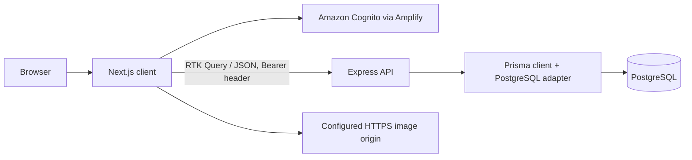

# Project Management Dashboard

A web-based project and task management dashboard with project boards, task views, priority lists, team and user directories, search, and timelines. The repository contains a Next.js client and an Express API backed by PostgreSQL through Prisma.

## Overview

The client is a Next.js App Router application. It uses Redux Toolkit Query to load and mutate project data from the Express API, AWS Amplify UI/Auth for Cognito sign-in, and Tailwind CSS for styling. The API exposes JSON endpoints for projects, tasks, users, teams, and search. Prisma models the relational data in PostgreSQL.

The repository does not include AWS Cognito provisioning, automatic synchronization of Cognito accounts into database users, a production deployment pipeline, or a functioning automated test suite. See [Architecture](docs/architecture.md) and [Development](docs/development.md) for verified limitations and setup details.

## Features

- Dashboard with task priority and project status charts.
- Project task board with drag-and-drop status changes, plus list, table, and Gantt timeline views.
- Project-wide and user-specific task retrieval.
- Priority-specific task views: urgent, high, medium, low, and backlog.
- User and team directories.
- Search across task titles/descriptions, project names/descriptions, and usernames.
- AWS Cognito sign-in UI and client-side token attachment to API requests.
- Persistent client display preferences using Redux Persist.

## Technology

| Area | Technologies |
| --- | --- |
| Web client | Next.js 14, React 18, TypeScript |
| Client state and API | Redux Toolkit, RTK Query, Redux Persist |
| UI and visualizations | Tailwind CSS, MUI X Data Grid, Recharts, `gantt-task-react`, React DnD |
| Sign-in | AWS Amplify UI and Amplify Auth with Amazon Cognito |
| API | Node.js, Express 5, TypeScript, Helmet, CORS, Morgan |
| Data | PostgreSQL, Prisma 7, `@prisma/adapter-pg` |
| Package management | npm; separate lockfiles in `client/` and `server/` |

## Architecture



The API currently does not authenticate or authorize requests; the bearer header is attached by the client but is not checked by the server. See [architecture.md](docs/architecture.md) for the component and request-flow details.

## Repository layout

```text
client/
  src/app/          Next.js routes, layouts, and project views
  src/components/   Shared React components
  src/features/     Dashboard, project, priority, and task UI
  src/providers/    Redux, theme, and Cognito provider composition
  src/state/        UI preferences and RTK Query API definitions
  src/store/        Redux store and persistence configuration
  src/lib/          Client-side helpers
  public/           Static images and assets
server/
  src/index.ts      Express application setup and listen call
  src/routes/       Express route definitions
  src/controllers/  API request handlers
  src/lib/          Prisma client setup
  prisma/           Schema, migrations, seed script, and seed fixtures
docs/               Architecture, database, API, and development guides
```

See [development.md](docs/development.md) for a fuller map and the local workflow.

## Prerequisites

- Node.js and npm. The repository does not pin a Node.js version; use a currently supported Node.js LTS release compatible with the package dependencies.
- PostgreSQL reachable from the API process.
- An Amazon Cognito User Pool and app client for interactive sign-in.
- An HTTPS image origin for user profile pictures and task attachments. The Next.js image configuration requires `NEXT_PUBLIC_IMAGE_BASE_URL` to be a valid HTTPS URL.

## Local setup

Run commands from the repository root unless a command explicitly changes directory.

1. Install the two packages independently:

   ```sh
   cd client && npm ci
   cd ../server && npm ci
   ```

2. Create local environment files from the safe templates:

   ```sh
   [ -f client/.env.local ] || cp client/.env.example client/.env.local
   [ -f server/.env ] || cp server/.env.example server/.env
   ```

   The commands leave existing local files untouched. Edit the files for your PostgreSQL connection, Cognito User Pool, API address, and image origin. The Cognito and image values in the examples are placeholders, not working service configuration. `NEXT_PUBLIC_*` values are included in browser-visible client configuration; do not put secrets in them.

3. Generate the Prisma client, apply migrations, and optionally load the sample data:

   ```sh
   cd server
   npx prisma generate
   npx prisma migrate dev
   npm run seed
   ```

   `npm run seed` is optional and is intended for a fresh database. The seed script's `deleteAllData()` function is currently empty, so it does not reset existing data; repeated runs can fail on unique constraints or duplicate data.

4. Start the API and web app in separate terminals:

   ```sh
   cd server && npm run dev
   ```

   ```sh
   cd client && npm run dev
   ```

   The API defaults to `http://localhost:3001`; the client defaults to `http://localhost:3000`. Set `NEXT_PUBLIC_API_BASE_URL` to the API origin, including a trailing slash as shown in the example, and ensure the database has user records corresponding to the Cognito identities used to sign in.

## Environment variables

| Variable | Package | Purpose |
| --- | --- | --- |
| `DATABASE_URL` | Server | PostgreSQL connection string used by Prisma and the PostgreSQL adapter. |
| `PORT` | Server | HTTP listen port; defaults to `3001` when unset or not a valid number. |
| `NEXT_PUBLIC_API_BASE_URL` | Client | Base URL used by RTK Query to reach the Express API. |
| `NEXT_PUBLIC_IMAGE_BASE_URL` | Client | HTTPS origin for profile and attachment images; its hostname is also used to configure Next.js remote images. |
| `NEXT_PUBLIC_COGNITO_USER_POOL_ID` | Client | Cognito User Pool identifier for Amplify Auth. |
| `NEXT_PUBLIC_COGNITO_USER_POOL_CLIENT_ID` | Client | Cognito app client identifier for Amplify Auth. |

See [`client/.env.example`](client/.env.example) and [`server/.env.example`](server/.env.example) for placeholders and setup notes.
Next.js `NEXT_PUBLIC_*` values are exposed in browser code and are embedded when the client is built; configure them before running `npm run build`. They must not contain secrets.

## Database

The Prisma schema defines users, teams, projects, project-team links, tasks, assignments, attachments, and comments. SQL migrations are under `server/prisma/migrations/`; the schema currently uses PostgreSQL. See [database.md](docs/database.md) for tables, relationships, and migration behavior.

## Development, build, and testing

The client and server have independent npm scripts and must be run from their respective directories.

```sh
# Client
cd client
npm run lint
npm run build
npm run start

# Server (from another terminal)
cd server
npm run build
npm start
```

`npm start` in the server package builds before launching the compiled API. There is no client test script. The server's `npm test` script is a placeholder that exits with an error; no automated test suite is configured. See [development.md](docs/development.md) for script behavior and formatting guidance.

## API reference

The API listens at the configured server port and uses the route prefixes `/projects`, `/tasks`, `/search`, `/users`, and `/teams`. The complete endpoint list, request bodies, response shapes, and error behavior are in [api.md](docs/api.md).

## Deployment

The repository does not define a production deployment pipeline or production process manager configuration. The checked-in PM2 ecosystem file starts the server's development script with `NODE_ENV=development`; it should not be treated as a production deployment recipe. Build and start the client and API using their package scripts only after supplying production-ready database, Cognito, API, and image configuration. Configure production CORS, authentication/authorization, secrets, and service operations for the target hosting environment before exposing the API.

## Troubleshooting

- **Prisma cannot connect:** Confirm PostgreSQL is running and `server/.env` contains a valid `DATABASE_URL`. Run Prisma commands from `server/`, where `prisma7.config.ts` is located.
- **Generated Prisma client is missing:** Run `npx prisma generate` in `server/` after installing dependencies or changing the Prisma schema.
- **Next.js image configuration fails:** Set `NEXT_PUBLIC_IMAGE_BASE_URL` to a valid HTTPS URL before starting or building the client.
- **Client requests fail:** Check that `NEXT_PUBLIC_API_BASE_URL` points to the Express API and that `PORT` matches the server's actual listen port. The API has no configured route prefix beyond the resource paths.
- **Sign-in succeeds but the dashboard does not load user data:** The client looks up a database user by Cognito subject at `GET /users/cognitoId/:id`. Sign-up does not automatically create that database row; provision a matching user record through the existing API or database workflow.
- **Seed command fails on existing data:** The seed cleanup routine is empty. Use a disposable/empty development database rather than expecting the seed command to reset it.

## Contributing

See [CONTRIBUTING.md](CONTRIBUTING.md) for setup, checks, and suggested pull request practices. Repository-specific branch and commit policies are not established in the checked-in files.

## License

No license file or license declaration was found in the repository. No licensing terms are asserted here.
