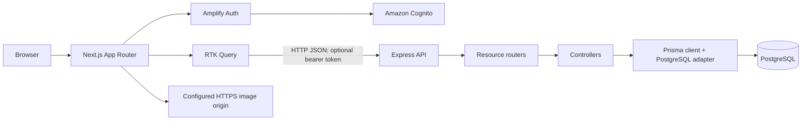

# Architecture

## System overview

The repository contains two independently installed packages:

- **Web client (`client/`)**: a Next.js 14 App Router application using React 18 and TypeScript. It renders the dashboard and project/task views in the browser.
- **API (`server/`)**: an Express 5 JSON API. Route modules map resource URLs to controller functions, which query or mutate PostgreSQL through Prisma 7.
- **External services**: the client uses AWS Amplify Auth with an Amazon Cognito User Pool. Profile and attachment images are requested from a configured HTTPS image origin.
- **Database**: PostgreSQL, with schema history managed by Prisma migrations.

The client calls the Express API directly; this repository contains no Next.js API route handlers or proxy. The API mounts routers at `/projects`, `/tasks`, `/search`, `/users`, and `/teams`, without an `/api` prefix.

## Startup and request flow

1. The Next.js root layout composes the Redux store, theme provider, Cognito `Authenticator`, shared navigation, and the active page.
2. Amplify Auth signs in the browser user against the configured Cognito User Pool.
3. RTK Query uses `NEXT_PUBLIC_API_BASE_URL` as its base URL. Its header preparation obtains the current Amplify access token and adds a bearer `Authorization` header when a token exists.
4. On application-user lookup, the client obtains the Cognito subject and requests `GET /users/cognitoId/:id`. The application profile is stored in PostgreSQL separately from Cognito.
5. Express parses JSON and URL-encoded bodies, applies Helmet, request logging, and default CORS middleware, then invokes a route handler.
6. Controllers call Prisma, which uses `@prisma/adapter-pg` and the configured `DATABASE_URL` to connect to PostgreSQL.

The API does **not** verify the bearer token or implement authorization middleware. Requests are not protected by Cognito merely because the client sends a token. CORS is enabled without an explicit origin allowlist. Do not expose this API as a protected production service without adding and configuring server-side identity verification and authorization.

The client does not automatically create an application `User` after Cognito sign-up. A matching database row with the Cognito subject must already exist for the application profile lookup to succeed. The API has `POST /users`, but no automatic synchronization or provisioning flow is implemented.

## Client components

| Area | Responsibility |
| --- | --- |
| `client/src/app/` | App Router pages and root layout. Dynamic route segments are used for project IDs and priority slugs. |
| `client/src/components/` | Shared application shell, navigation, buttons, and modal components. |
| `client/src/features/dashboard/` | Dashboard task-priority chart, project-status chart, and current user's task table. Project status is inferred as `Completed` when `endDate` is set and `Active` otherwise; it is not a persisted project field. |
| `client/src/features/projects/` | Project board, list, table, and timeline views, plus project/task UI. |
| `client/src/features/priority/` | Current-user tasks filtered by selected priority. |
| `client/src/features/tasks/` | Task creation and task cards. |
| `client/src/state/api.ts` | RTK Query endpoint definitions and client-side API types. |
| `client/src/state/global-slice.ts` | UI preferences such as sidebar state, theme, and selected views. |
| `client/src/store/store.ts` | Redux store; Redux Persist stores only the `global` slice in browser local storage. |
| `client/src/providers/` | Store, theme, and Amplify Auth provider composition. |
| `client/public/` | Static images and other public assets. |

### User-facing routes

| Route | Responsibility |
| --- | --- |
| `/` | Dashboard page. |
| `/projects/:id` | A project task view: board, list, timeline, or table. The selected tab is a persisted client preference. |
| `/priority/urgent`, `/priority/high`, `/priority/medium`, `/priority/low`, `/priority/backlog` | Current-user tasks filtered by priority. Other priority slugs render a not-found page. |
| `/timeline` | Gantt timeline of projects using each project's start and end dates. |
| `/search` | Search results for tasks, projects, and users. |
| `/users` | User directory. |
| `/teams` | Team directory and team role holders. |
| `/settings` | Settings page with static values; settings are not persisted by a settings API. |

## API components

`server/src/index.ts` creates and starts the Express application. `server/src/routes/` defines resource routes; `server/src/controllers/` contains request handlers and Prisma operations. `server/src/lib/prisma.ts` constructs the Prisma client and PostgreSQL adapter. The server listens on `0.0.0.0` and uses `PORT`, defaulting to `3001`.

The API currently has no shared request-validation layer, centralized error middleware, API version prefix, or checked-in OpenAPI specification. The route and response reference is in [api.md](api.md).

## Persistence

The Prisma schema models users, teams, projects, project/team links, tasks, task assignments, attachments, and comments. `ProjectTeam` and `TaskAssignment` are explicit association tables. In addition, `Task` has a direct optional assignee reference; the current API uses that field and does not manage `TaskAssignment`. See [database.md](database.md) for keys, relationships, and migration history.

## Operational gaps

- Server-side authentication and authorization are not implemented.
- Cognito sign-up is not synchronized to the application's user table.
- The API exposes database exception messages in HTTP 500 responses.
- Team routes are read-only; the settings page is static.
- The project page does not load project details by ID, and its header currently displays a fixed project name.
- Attachment rows contain references only; no upload or storage integration is implemented.
- The seed script does not clear existing data and is not idempotent.
- No automated tests, CI workflow, or production deployment pipeline are configured in the repository.
- `server/ecosystem.config.cjs` runs the development command with `NODE_ENV=development`; it is not a production process configuration.
