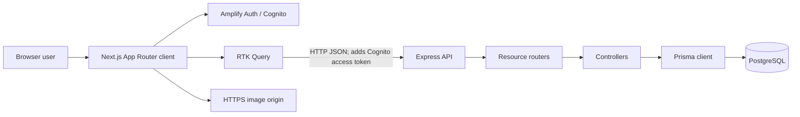

# Architecture

## System overview

The repository is a small web application split into two independently installed packages:

- **Client (`client/`)**: Next.js App Router and React pages. Redux Toolkit Query requests data from the API; AWS Amplify UI/Auth provides a Cognito sign-in interface. Tailwind, MUI X Data Grid, Recharts, `gantt-task-react`, and React DnD support the user interface.
- **API (`server/`)**: Express JSON endpoints, grouped into route modules and controller handlers. Prisma accesses PostgreSQL through `@prisma/adapter-pg`.
- **External services**: Amazon Cognito is configured in the browser. The client also loads profile and attachment images from an HTTPS image origin configured at build/runtime through a public environment variable.
- **Database**: PostgreSQL schema managed by Prisma migrations.



The client has no Next.js API route handlers in this repository; API calls go directly to the configured Express origin. The Express application mounts resource routers at the root-level paths `/projects`, `/tasks`, `/search`, `/users`, and `/teams`.

## Request and authentication flow

1. `AuthProvider` configures Amplify with the Cognito User Pool ID and app client ID and renders the Amplify `Authenticator`.
2. RTK Query's `fetchBaseQuery` obtains the Amplify access token and, when available, adds `Authorization: Bearer <access-token>` to outgoing API requests.
3. `getAuthUser` obtains the current Amplify user and Cognito subject, then looks up a corresponding application user using `GET /users/cognitoId/:id`.
4. Express parses JSON and URL-encoded bodies, applies Helmet, request logging, and default CORS middleware, then invokes a route handler.
5. Controllers call Prisma and return JSON responses.

**Important boundary:** The API does not include JWT verification or authorization middleware. It does not validate the bearer token; attaching a token in the client does not make API endpoints protected. CORS is enabled with the library defaults rather than a configured allowlist. Do not interpret the current application as providing server-side access control.

**Account provisioning:** The client authentication code does not invoke `POST /users` after sign-up. A Cognito account must also have a matching database user row for the current client lookup to succeed. The API has a user-creation endpoint, but no automatic identity-to-database synchronization flow is implemented.

## Client responsibilities

- **Routes and page composition**: `client/src/app/` contains the root layout and dashboard pages. `src/app/projects/[id]/page.tsx` chooses a project view based on persisted client state.
- **Shared UI**: `client/src/components/` contains navigation, cards, buttons, and task/project modals.
- **State and API**: `client/src/state/api.ts` defines RTK Query endpoints and response types; `src/state/index.ts` defines display preferences. `src/app/redux.tsx` creates the store and persists only the `global` slice in browser local storage.
- **Authentication**: `src/app/authProvider.tsx` configures Cognito browser authentication; `src/app/dashboardWrapper.tsx` composes Redux, authentication, sidebar, and navigation.
- **Visualizations**: The dashboard uses Recharts; task and project views use MUI Data Grid and Gantt charts.

### User-facing routes

| Route | Responsibility |
| --- | --- |
| `/` | Dashboard overview; imports the home dashboard page. |
| `/home` | Dashboard charts and current user's task table. |
| `/projects/:id` | Board, list, timeline, or table view for a project's tasks. |
| `/priority/urgent`, `/priority/high`, `/priority/medium`, `/priority/low`, `/priority/backlog` | Current user's tasks filtered by priority. |
| `/timeline` | Project timeline. |
| `/search` | Search results for tasks, projects, and users. |
| `/users` | User directory. |
| `/teams` | Team directory and role holders. |
| `/settings` | Static settings display; the values are hard-coded in the page. |

## API responsibilities

`server/src/index.ts` creates the Express application, middleware, root response, and resource mounts. Each file in `server/src/routes/` maps HTTP paths to controller functions in `server/src/controllers/`. `server/src/lib/prisma.ts` constructs a Prisma client using a PostgreSQL driver adapter and `DATABASE_URL`.

API endpoints and precise response contracts are listed in [api.md](api.md). There is no API version prefix, central request schema validation, or shared error middleware.

## Persistence model

Prisma models users, teams, projects, project-team associations, tasks, task assignments, attachments, and comments. Foreign keys are defined in the migrations. The schema and relation details are in [database.md](database.md).

## Repository map

```text
client/
  public/                  Static images and icons
  src/app/                 Next.js route pages, root layout, project views
  src/components/          Reusable React interface components
  src/lib/                 Client-side helpers
  src/state/               Redux state and RTK Query API
server/
  prisma/                  Prisma schema, SQL migrations, seed script/data
  src/controllers/         API request handlers
  src/generated/prisma/    Locally generated Prisma client (git-ignored)
  src/lib/                 Prisma client construction
  src/routes/              Express routers
docs/                      Project documentation
```

## Current gaps and operational considerations

- The API accepts unauthenticated requests and has no authorization rules.
- Cognito sign-up and database user creation are separate; no linking/provisioning hook exists in the client.
- User, team, and settings functionality is partial: users and teams are fetched, while settings are hard-coded; no team mutation endpoints are defined.
- Prisma seed cleanup is an empty function, and the seed script is not a reset operation.
- No automated tests or production deployment pipeline are configured.
- The checked-in PM2 ecosystem config invokes the development command with `NODE_ENV=development`; it is not production process configuration.
- No versioned API specification is present; endpoint documentation is maintained in [api.md](api.md).
