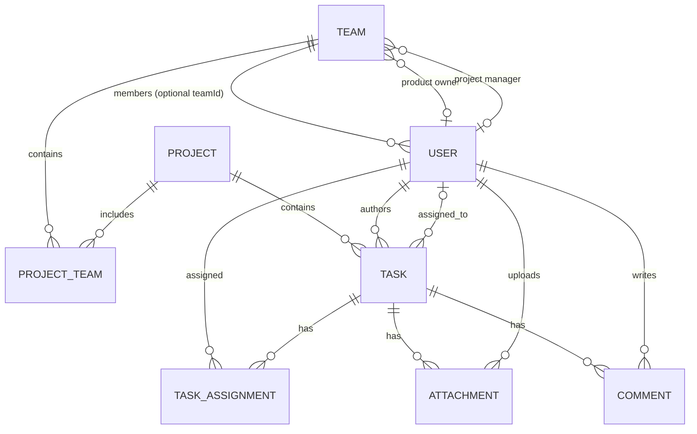

# Database

## Engine and configuration

The application uses PostgreSQL. The Prisma schema is `server/prisma/schema.prisma`, and the Prisma 7 configuration in `server/prisma7.config.ts` reads the datasource URL from `DATABASE_URL`. The generated client is written to `server/src/generated/prisma/`, which is ignored by Git and must be generated locally.

Apply the committed migrations from the `server/` directory:

```sh
npx prisma generate
npx prisma migrate dev
```

For production deployment, apply committed migrations with `npx prisma migrate deploy` rather than creating new development migrations. This repository does not include deployment automation for that operation.

## Entity relationship overview



`o|` indicates an optional reference. `ProjectTeam` and `TaskAssignment` are explicit association models with their own integer IDs.

## Models

| Model | Fields and purpose |
| --- | --- |
| `User` | `id` (autoincrement primary key), unique `cognitoId`, unique `username`, optional `profilePictureUrl`, optional `teamId`. Relates to authored/assigned tasks, task assignments, attachments, comments, and teams for membership or leadership. |
| `Team` | `id`, `teamName`, optional `productOwnerUserId`, optional `projectManagerUserId`. Has users and project-team links. |
| `Project` | `id`, `name`, optional `description`, optional `startDate` and `endDate`. Has tasks and project-team links. |
| `ProjectTeam` | `id`, required `teamId`, required `projectId`; joins projects to teams. |
| `Task` | `id`, `title`, required string `status` and `priority`, optional `description`, `tags`, `startDate`, `dueDate`, and `points`; required `projectId` and `authorUserId`; optional `assignedUserId`. |
| `TaskAssignment` | `id`, required `userId`, required `taskId`; explicit user-task assignment association. |
| `Attachment` | `id`, required `fileURL`, optional `fileName`, required `taskId` and `uploadedById`. Stores a URL/path reference, not file bytes. |
| `Comment` | `id`, required `text`, `taskId`, and `userId`. |

All model identifiers are PostgreSQL serial/integer primary keys. Prisma `DateTime` fields map to PostgreSQL `TIMESTAMP(3)` in the initial migration; dates are not modeled as timezone-aware database columns.

## Relationships and constraints

- `User.cognitoId` and `User.username` are unique.
- A user's `teamId` is optional and references one team. Deleting that team sets the membership reference to `NULL`.
- Each team may reference one product owner and one project manager; both references are optional and set to `NULL` when the referenced user is deleted.
- `ProjectTeam` references one team and one project. The schema does not declare a unique constraint on `(teamId, projectId)`.
- A task belongs to one project and has one required author. Its assignee is optional; deleting the assignee sets `assignedUserId` to `NULL`.
- `TaskAssignment` separately associates users and tasks. No composite unique constraint is defined, and this join is distinct from `Task.assignedUserId`.
- Attachments and comments each reference one task and one user. The migrations use restrictive foreign keys for these records and for required task/project references; referenced rows cannot be deleted while these references remain.
- Other relation foreign keys use the database's default restrictive delete behavior unless noted above.

## Modeling decisions and current behavior

- `status` and `priority` are strings in PostgreSQL and Prisma, not database or Prisma enums. The client currently uses statuses `To Do`, `Work In Progress`, `Under Review`, `Completed` and priorities `Urgent`, `High`, `Medium`, `Low`, `Backlog`; the API does not enforce those sets.
- `tags` is a nullable string. The task UI splits and joins comma-separated values rather than using a normalized tag table.
- `ProjectTeam` supports many-to-many project/team membership. A user's `teamId` independently represents one primary team association.
- `Attachment.fileURL` is a stored reference. The client renders it relative to the configured image origin; upload/storage handling is not implemented in the API.
- Dates and numeric values are nullable where the schema marks them optional. The UI timeline views currently construct chart dates directly from the task/project date values, so records without dates may not produce meaningful timeline entries.
- The `TaskAssignment` model and direct task assignee field represent two assignment mechanisms. The API endpoints documented today use `Task.assignedUserId`; they do not manage `TaskAssignment`.

## Migrations

Migrations are applied in timestamp order:

1. `20261117174903_init`: creates all core tables, user unique indexes, and foreign keys. In this initial SQL, `Project.description` is non-null.
2. `20261118144516_init`: makes `Project.description` nullable, matching the current Prisma schema.
3. `20261123151948_init`: adds team product-owner and project-manager foreign keys.

The `prisma/migrations` directory is the database change history; edit the Prisma schema and create migrations through Prisma rather than editing an already-applied migration.

## Seed data

Sample JSON fixtures are in `server/prisma/seedData/`. Run the seed script from `server/` with `npm run seed`. The script inserts teams, projects, users, project-team links, tasks, attachments, comments, and assignments in a defined order, then assigns team leaders.

The `deleteAllData()` function in `server/prisma/seed.ts` is currently empty. The script does not clear or reset tables and is not idempotent; use it only with a fresh development database. The script is separate from Prisma's migration commands.
